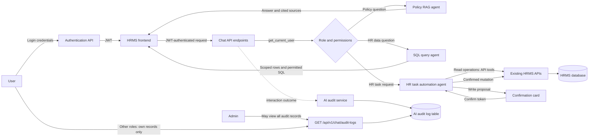

# AI Architecture

## Overview

The HRMS exposes three separate AI capabilities through authenticated FastAPI endpoints. The frontend sends the user's JWT with each request. FastAPI resolves the current user and role before invoking an agent. There is no single intent-classification router: the user-facing feature calls the policy, SQL, or actions endpoint directly.

## Authentication and Authorization

- Users authenticate through the existing auth API and send the resulting bearer JWT to AI endpoints.
- Chat endpoints use `get_current_user` to derive the authenticated employee and role. The role is not trusted from the message or frontend request body.
- `backend/app/services/ai/permissions.py` defines the SQL role scopes and the action-tool allowlist for `EMPLOYEE`, `MANAGER`, and `ADMIN`.
- The SQL agent creates role-scoped temporary tables before executing a query. Employees are limited to their own records, managers to themselves and direct reports for scoped records, and admins to broad allowed HR data. Shared catalog tables are treated separately.
- Sensitive columns are removed from the SQL schema and blocked by validation and SQLite authorization for every role.
- The action API endpoints also enforce their own authorization. Agent permissions do not replace backend API authorization.

## Policy RAG Assistant

**Endpoint:** `POST /api/v1/chat/policy`

1. `backend/app/services/ai/policy_rag.py` reads the approved policy files, extracts text and source metadata, and splits the content into retrieval chunks.
2. `backend/app/services/ai/embeddings.py` creates document and query embeddings using the configured OpenAI embedding model.
3. `backend/app/services/ai/vector_store.py` stores and searches the local JSON vector index. Retrieval scores chunks with cosine similarity and returns the top five.
4. `policy_rag.py` refuses retrieval when the highest similarity is below `POLICY_RAG_MIN_SIMILARITY` (default `0.28`). Otherwise, it asks the configured chat model to answer from the retrieved excerpts and validates the cited source IDs.
5. The response includes the answer and source metadata. Unsupported questions are refused rather than answered from model memory.

The index is cached in process and persisted locally by default at `POLICY_UPLOAD_DIR/policy-rag-index.json`. The index is rebuilt when its source-document fingerprint or embedding model changes.

**Main files:**

- `backend/app/services/ai/policy_rag.py`
- `backend/app/services/ai/embeddings.py`
- `backend/app/services/ai/vector_store.py`
- `backend/app/core/config.py`
- `backend/app/api/v1/endpoints/chat.py`

## SQL Query Agent

**Endpoint:** `POST /api/v1/chat/sql`

1. `backend/app/services/ai/sql_guardrails.py` introspects the database and builds a schema from role-scoped temporary tables, excluding blocked columns.
2. `backend/app/services/ai/sql_agent.py` gives the model that schema, verified relationships, role scope, and safe table/column descriptions before asking it for a query.
3. `clean_generated_sql` uses SQLGlot to parse the generated SQL and enforce a single allowed `SELECT`, approved tables, and blocked-column rules. Non-SELECT statements, multiple statements, disallowed tables, and restricted columns are rejected.
4. `execute_scoped_select` opens SQLite with `mode=ro`, creates temporary tables filtered to the user's role, registers a SQLite authorizer, applies a query time limit, and caps results at 100 rows.
5. The authorizer allows reads from the scoped temporary tables and safe columns, while denying access to the underlying database tables and restricted fields.
6. Correctable syntax or schema errors receive at most one repair attempt. The repaired query goes through the same SQL validation and scoped execution; authorization failures are not repaired.

Raw SQL is returned only for roles whose permissions allow it. The role scope is enforced by the server even if the model omits a filter.

**Main files:**

- `backend/app/services/ai/sql_agent.py`
- `backend/app/services/ai/sql_guardrails.py`
- `backend/app/services/ai/permissions.py`
- `backend/app/api/v1/endpoints/chat.py`

## HR Task Automation Agent

**Endpoint:** `POST /api/v1/chat/actions`

1. `backend/app/services/ai/action_agent.py` supplies the model only with tools allowed for the authenticated user's role. The agent is not given a database session or SQL execution tool.
2. `backend/app/services/ai/api_tools.py` implements the available tools as calls to existing authenticated HRMS APIs. Read operations call APIs directly. For example, project assignment resolves employee and project names through read APIs, then uses the existing assignment API for the write.
3. Mutating tools are listed in `ACTION_WRITE_TOOLS`. The agent does not execute these when first proposed. Instead, it returns a confirmation summary and a signed, short-lived token containing the user, role, tool, and arguments.
4. The frontend displays the confirmation card. On confirmation it sends the token to the same chat endpoint. `confirm_hr_action` validates the token, checks the user's role/tool permission, prevents reuse within the process, and only then calls `execute_action_tool` to invoke the existing API.
5. Business validation and database mutation remain within the existing API/service layer, not in the agent.

**Main files:**

- `backend/app/services/ai/action_agent.py`
- `backend/app/services/ai/api_tools.py`
- `backend/app/services/ai/permissions.py`
- `backend/app/api/v1/endpoints/chat.py`
- `frontend/app/automate-hr-tasks/page.tsx`
- `frontend/components/ai/action-result-card.tsx`

## AI Audit Logging

The chat API records the interaction outcome through `backend/app/services/ai/audit.py` and the `ai_audit_logs` model/table. Logged fields include the user ID, role, message or confirmation marker, intent, tool/API label, status, and timestamp. The audit helper writes through the application database session; this is separate from the AI agents' access and does not give an agent direct database access.

**Endpoint:** `GET /api/v1/chat/audit-logs`

The endpoint requires authentication. Admins may view audit records across users; other roles are restricted to their own records. Results support intent/status filters and pagination. A confirmed action is logged separately from the initial proposal.

**Main files:**

- `backend/app/services/ai/audit.py`
- `backend/app/models/ai_audit_log.py`
- `backend/app/api/v1/endpoints/chat.py`

## Configuration

Relevant settings are defined in `backend/app/core/config.py` and loaded from the backend environment:

- `OPENAI_API_KEY`
- `OPENAI_MODEL`
- `OPENAI_EMBEDDING_MODEL`
- `POLICY_RAG_SOURCE_DIR`
- `POLICY_RAG_INDEX_PATH`
- `POLICY_RAG_MIN_SIMILARITY`
- `POLICY_UPLOAD_DIR`
- `DATABASE_URL`

## Notes and Limitations

- The RAG index is a local JSON file, not a managed vector database. It is cached in each API process.
- There is currently no single semantic router or unified chat panel that directs a user's request to the policy, SQL, or HR task agent. The frontend selects the agent-specific endpoint explicitly. A unified semantic router/chat experience is a possible Phase Two enhancement.
- Admins cannot currently upload a policy document and have it dynamically ingested into the Policy RAG index. An admin workflow for uploading, processing, and refreshing the RAG index can be implemented later.
- Persistent chat sessions and conversation transcripts are not currently implemented. The `/sessions` and `/sessions/{session_id}/messages` endpoints are `501 NOT_IMPLEMENTED` stubs, and there are no chat-session or chat-message database models. Each chat page keeps messages in React state and sends up to the last eight messages as request context for SQL and HR task automation; this state is lost when the page is reloaded or left. Policy RAG accepts a history field but currently discards it. This means there is no database-backed conversation history per employee, manager, or admin.
- AI audit logs persist individual requests and their outcome/status, but they are not a restorable conversation transcript and do not store assistant replies as session messages. Browser-side or network-only error state is also not persisted.
